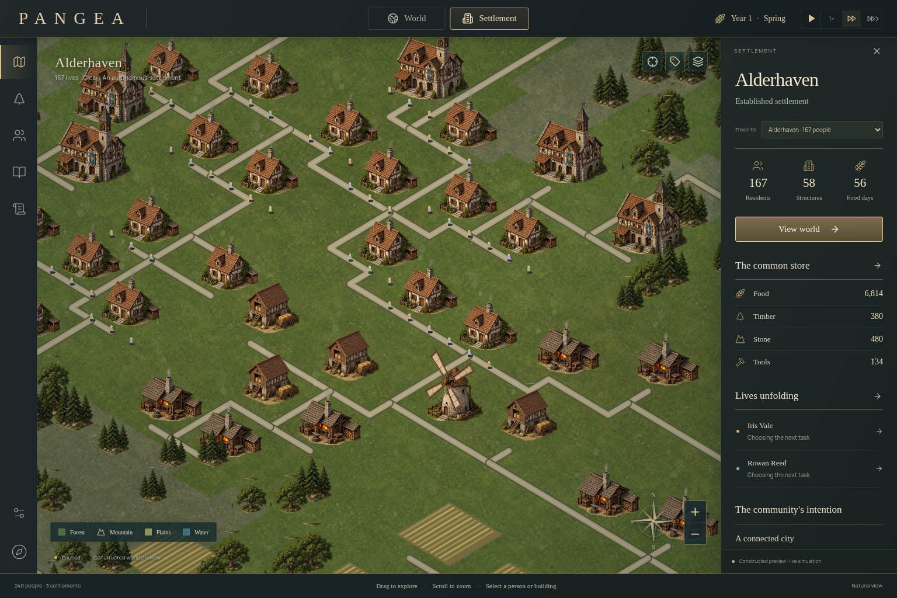

# PANGEA — A living world

PANGEA is an autonomous civilization simulation with an isometric world and individual city views. The active playable application is in **[pangea-isometric](pangea-isometric/README.md)**, built on a clone of [IsoCity](https://github.com/amilich/isometric-city) and connected to the existing PANGAEA Realms 0.5 simulation.



Fresh launches and new worlds generate random seeds. Enter an optional seed to recreate the same starting geography; saved games preserve their seed, terrain, people and settlements. Each settlement opens its own city with real streets, residents, construction, resources, research and production.

## Run

Node.js 22 or later:

```sh
cd pangea-isometric
npm ci
npm run dev
```

Open `http://localhost:3000`. The original IsoCity remains available at `/isocity`.

```sh
npm test
npm run lint:pangea
npx tsc --noEmit
npm run build
npm run build:standalone
```

The first screen is a labelled 240-person constructed preview, initially paused. World settings → **New world · Four founders** begins a natural simulation. Browser-local saves and portable JSON import/export are available in the world settings.

[Private playable preview](https://pangea-isometric-world-20261023.salpistorio.chatgpt.site) · [Verification notes](pangea-isometric/QA_PANGEA.md) · [Attribution](pangea-isometric/THIRD_PARTY_PANGEA.md)

## Project structure

- `pangea-isometric/` — active Next.js/React/Canvas application, seeded generation, typed simulation adapter, generated art, original IsoCity source/WebP assets and regression tests.
- `PANGAEA_Project_Full/` — preserved earlier simulation project, research, historical saves and evidence.

The runtime is currently browser-local. Server persistence, multiplayer, a seamless world-to-room landscape and a complete art progression across all eras remain future work. The generated atlas shares some illustrations across building classes.
