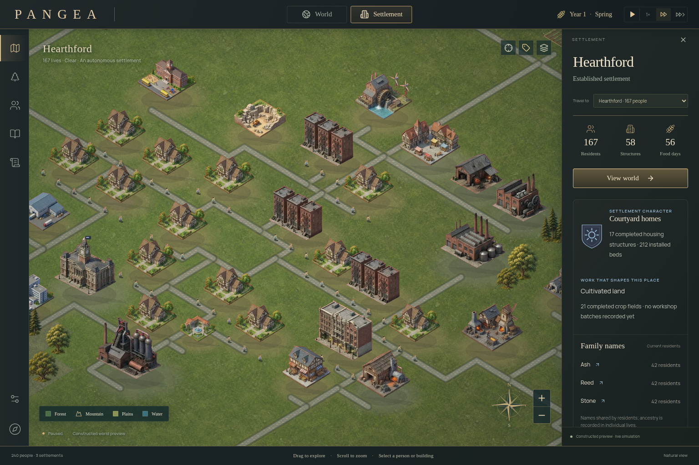
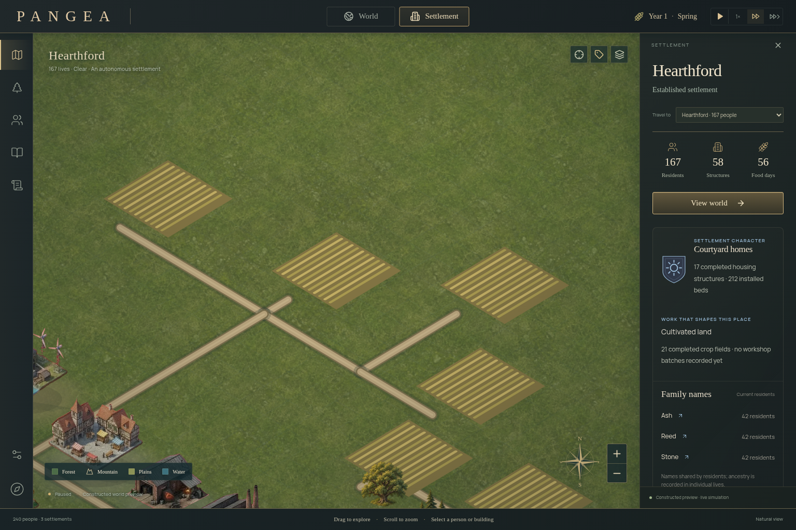
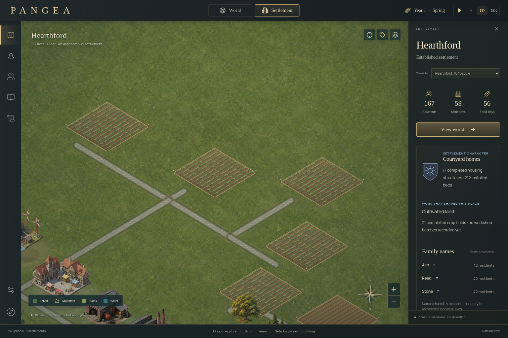
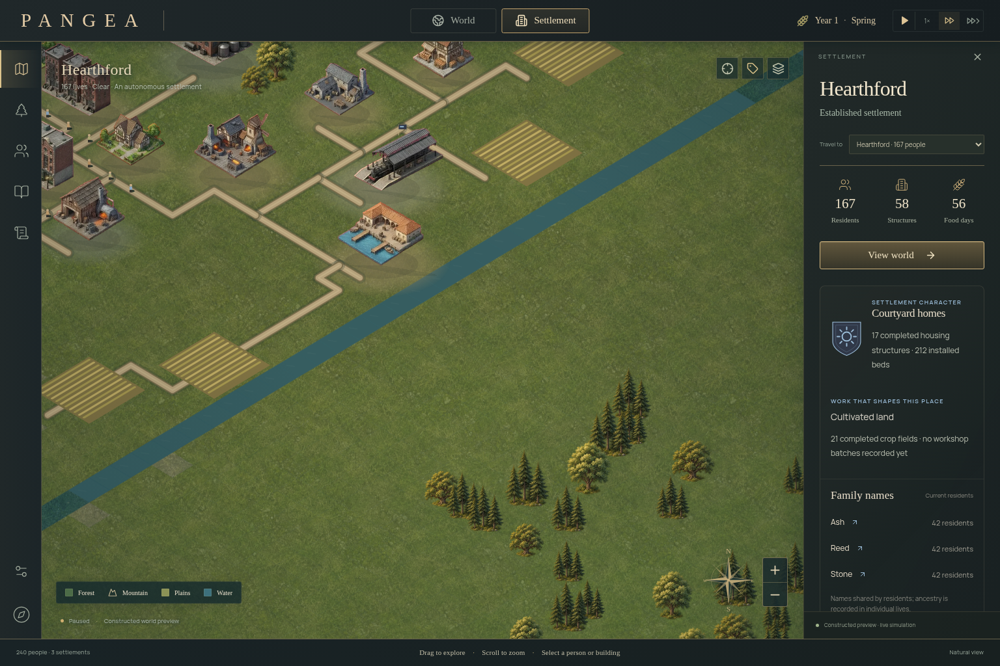
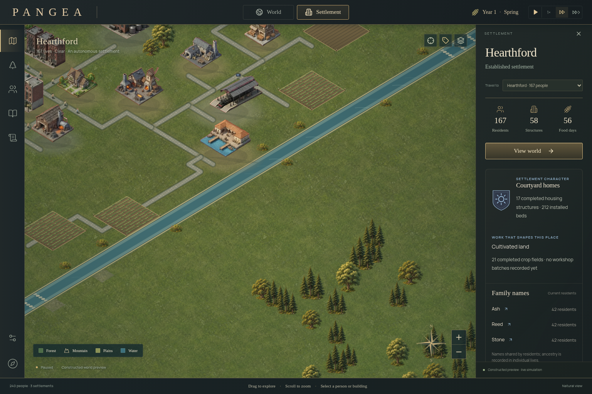
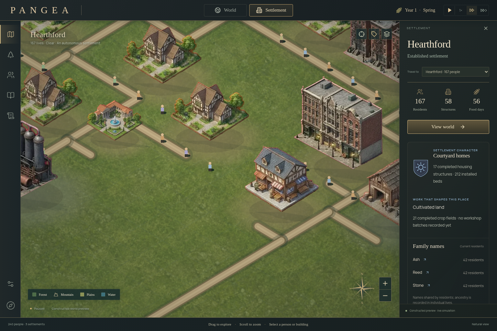
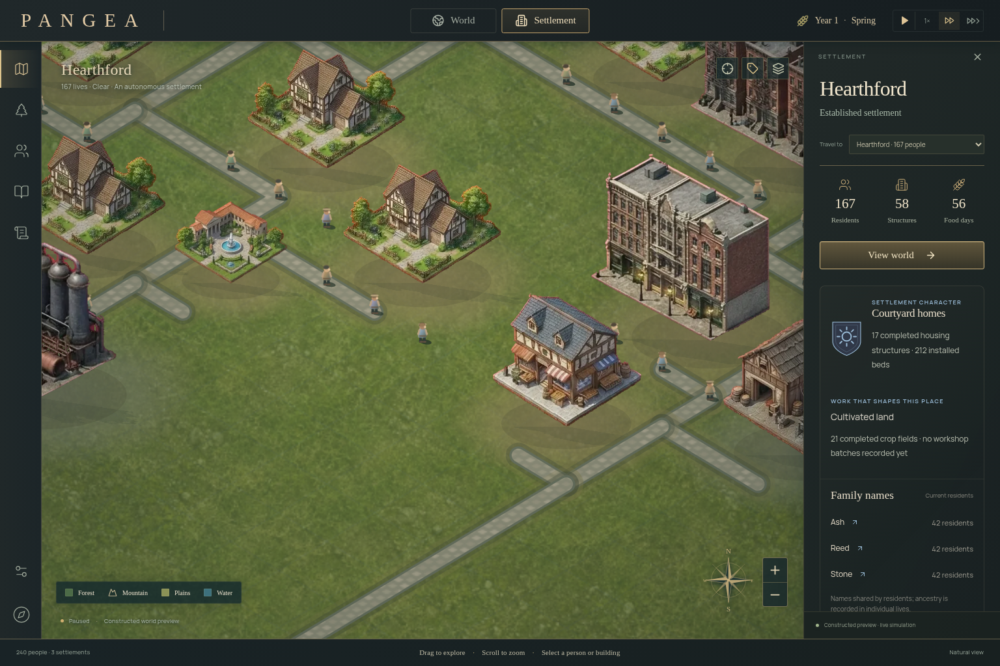
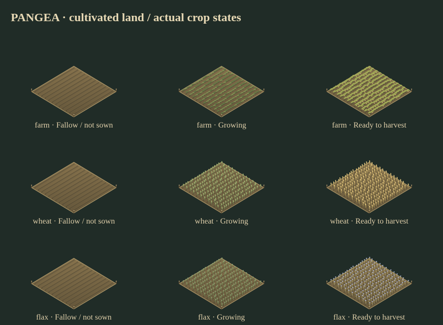

# PANGEA 0.8.1 — city detail

This pass builds on [PR #7](https://github.com/SalvatoreP888/PANGEA/pull/7), main `feb9cdcfc5547779e91365c4f1367682c5d29168`. It continues the Game Studio visual/playtest direction with read-only city art. No new dependency, third-party asset or simulation rule is introduced.

## Visible changes

- Residents have shaded coats, hair, shoes, stable visual variation, child scale, facing and a four-frame walking gait. Actual clothing color, age, position and walking task drive the miniature. Reduced motion stops gait animation. A bounded shared sprite cache avoids painting clothing on every frame.
- Crop fields distinguish bare soil, young plants, taller crops and a ripe harvest. Wheat has grain heads; mature flax has pale blue flowers. A field marked unsown stays bare even if its stored growth value is nonzero. The constructed preview grants buildings and resources; it does not manufacture a planting or harvest history.
- Local water follows closed, rounded contours derived from the actual water/river/ford cells. Layered banks, shallow edges, reflections and sparse reeds add detail. Dry islands remain dry; actual fords show stepping stones. Navigation and world/local river geometry remain unchanged.
- Real street tiers select trail, graded earth or muted stone paving. Worn shoulders, rounded ends and joins attach roads to the landscape. Roads now share the bounded settled-city raster; navigation revision invalidates both paths and pixels after actual resurfacing.
- Dusk gains a warm-to-cool directional wash while occupied windows retain their existing state-driven glow. Presentation lighting stays independent of accelerated simulation time.

## Before and after

The following pairs use the same paused 240-person constructed snapshot, seed 481217, camera and reduced-motion preference. City detail is rendered from real state; the crop contact sheet below separately demonstrates explicit crop states.

| View | 0.8 / PR #7 | 0.8.1 |
| --- | --- | --- |
| City |  |  |
| Fields |  |  |
| Riverbank |  |  |
| Residents |  |  |



[Dusk](screenshots/detail-dusk.png) · [Phone](screenshots/detail-phone.png)

## Verification and limits

All 121 existing Node regressions pass, including exact simulation/save and server checks. Strict lint, TypeScript, production build and both self-contained exports pass. Chromium playtests cover 30 general checks, eight evolution checks, nine camera checks and four offline groups. New pixel checks cover crop states, real task-driven gait/reduced motion, unchanged input state, dry water-mask islands and ford stones. [Detail results](qa/detail.json).

The paired renderer harness checks two city zooms and the world at desktop and DPR 2 phone sizes. Complete snapshots, entity hit geometry/order and sampled picks match the previous renderer. Moving, removing or marking an actual building unfinished still matches forced raster regeneration pixel-for-pixel. Changing actual street tiers with a navigation revision invalidates the cached roads; restoring the state restores the original pixels. [Paired report](qa/detail-visuals.json).

Performance is a bounded software-Chromium sample of a paused 1,000-person city, 24 paced frames after six warmups. CPU submission and RAF intervals are measured separately with only the timed canvas visible. The raw report includes before/after values; it is not a universal FPS or speedup claim. Cold terrain rebuilds and first-time sprite painting have separate costs. Physical devices and non-Chromium engines were not tested.

The private preview remains the same static app with device-local autosaves. The optional authoritative server and all earlier licenses/provenance are preserved. Procedural crops and residents are original Canvas code; shoreline vegetation reuses the original environment atlas already shipped in 0.8.

## Reproduce

```sh
npm ci
npm test
npm run lint:pangea
npm run build
npm run build:standalone
npm run build:site
npm run test:detail:browser
# Archive the PR #7 app separately for this paired comparison:
npm run test:visuals:browser -- --baseline /path/to/archived-0.8 --out work/visual-comparison
# Start npm start -- -p 3009 in another terminal:
PANGEA_URL=http://127.0.0.1:3009/ npm run test:browser
PANGEA_URL=http://127.0.0.1:3009/ npm run test:evolution
PANGEA_URL=http://127.0.0.1:3009/ npm run test:camera:browser
npm run test:standalone
```
