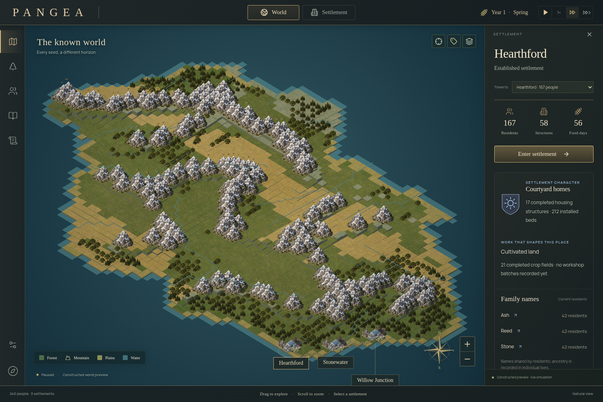
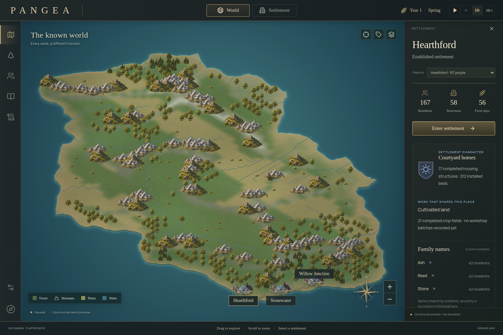
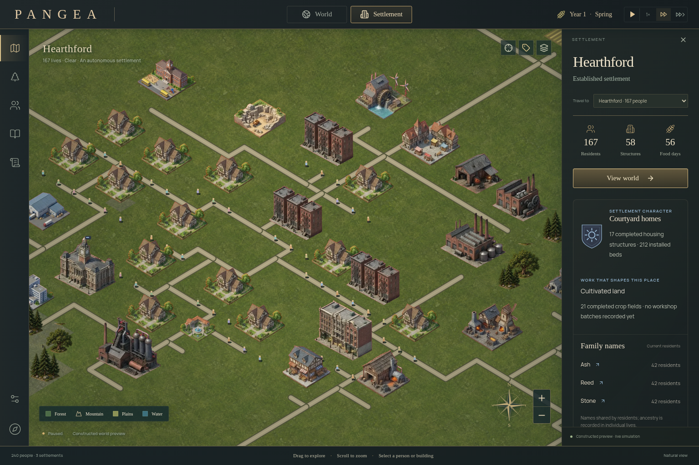

# PANGEA 0.8 visual direction and verification

This pass starts from the latest merged performance work: [PR #6](https://github.com/SalvatoreP888/PANGEA/pull/6), main `741e8f4fbd569024b23d68ee9f043d77bdd384e2`, merged 23 October 2026 at 11:32 EDT. The initial inspection found three dominant defects: raised faces on every world tile, repeated snowy mountain stickers, and building plots that looked detached from uniform grass.

Game Studio's game UI and playtest guidance informed the playfield, real input checks and desktop/phone review. Creative Production's style and source-preservation guidance informed the painted miniature direction and consistent upper-left light. The Creative Production board tool was unavailable in this session; one original environment atlas was generated with the available ImageGen tool and inspected in the rendered game. No comparison board or upstream contribution is claimed.

## What changed

- Continuous shared terrain vertices replace interior tile walls. The land silhouette clips at the authoritative sea threshold, interpolating coast crossings. Actual geography, founding coordinates and world rules are unchanged.
- A small bilinearly magnified material field blends sage grass, ochre soil and slate ridges. Shallow-water shelves and a narrow wash follow the land silhouette. All terrain/material work is cached during rebuilds.
- Eight original painted environment sprites add oak/linden/fir variation, connected alpine ridges, low rocky hills, meadow shrubs and wetland vegetation. World vegetation and settlement trees continue to follow actual geography/resource-node state; art creates no residents, resources or structures.
- Warm earth road materials, feathered worn ground and alpha-derived contact/cast shadows attach existing buildings to their plots. The 30 existing architectural sprites, their source notices and real era selection remain preserved.
- Collision-aware map labels choose positions inside the playfield instead of falling through the bottom edge. Entity hit targets remain tied to their actual projection. The HUD and primary controls stay familiar.

The exact generated source is retained at [environment-source.png](art/environment-source.png). The preparation script records inspected crop rectangles and source/output SHA-256 hashes. Generated rows were not evenly spaced, so crops follow actual object bounds. Output sprites are trimmed and compressed to WebP. Their manifest is `public/pangea/environment/manifest.json`. No new third-party art or runtime dependency is introduced.

## Before and after

Both images use the same explicit seed 481217 and the same paused 240-person constructed snapshot; reduced motion removes ambient timing differences. This is a real rendered world, not a generated scene used as the map.

| View | Before PR #6 | After |
| --- | --- | --- |
| World |  |  |
| Settlement |  |  |

Desktop 1536×1024, laptop 1280×800 and phone 390×844 layouts are reviewed, together with night presentation, terrain layers, camera transitions and selection. [Evidence](qa/visuals.json) includes exact state/pick checks and measured CPU/RAF samples.

## Preserve the performance merge

Simulation, transport, resident indexes, server serialization, browser polling and save code are unchanged. Native cached road paths and culling remain. The existing viewport terrain raster still releases in world view and remains capped at eight million pixels; it now also holds static plot/shadow pixels. Moving cameras and oversized viewports use direct rendering. Actual plot position, completion, type, navigation and discovered-art variants invalidate the raster. Activity, people, goods, crops, weather, selection and presentation lighting remain live outside it.

The paced comparison measures a paused 1,000-person constructed city at two zooms and a world view, after six warmup frames, across 24 frames. CPU submission and requestAnimationFrame intervals are separate; only the timed canvas is visible, avoiding occlusion bias. This is one software-Chromium run, not a universal FPS or speedup claim. The raw report preserves its exact values. The completed comparison retains a 16.7 ms median RAF interval in all three views; small CPU differences and cold rebuilds have different costs.

The visual harness compares full city hit geometry/order and sampled picks against the actual PR #6 renderer, with complete snapshots unchanged. World marker geometry also matches at a shared camera; label placement intentionally differs. Desktop and DPR 2 phone checks additionally move a real building, mark it unfinished, and remove it temporarily: the normal hot render must match a forced raster rebuild pixel-for-pixel, then restore the exact original snapshot.

## Reproduce

```sh
npm ci
npm test
npm run lint:pangea
npx tsc --noEmit
npm run build
npm run build:standalone
npm run build:site
# Production frontend in another terminal: npm start -- -p 3007
PANGEA_URL=http://127.0.0.1:3007/ npm run test:browser
PANGEA_URL=http://127.0.0.1:3007/ npm run test:evolution
PANGEA_URL=http://127.0.0.1:3007/ npm run test:camera:browser
npm run test:standalone
# Archive PR #6 app into a separate baseline directory first:
npm run test:visuals:browser -- --baseline /path/to/archived-0.7.2 --out work/visual-comparison
npm run prepare:environment
```

The offline export embeds all environment assets. Persistent server hosting remains a separate deployment, as documented previously; this visual change does not provision infrastructure. Physical devices and non-Chromium engines were not tested.
